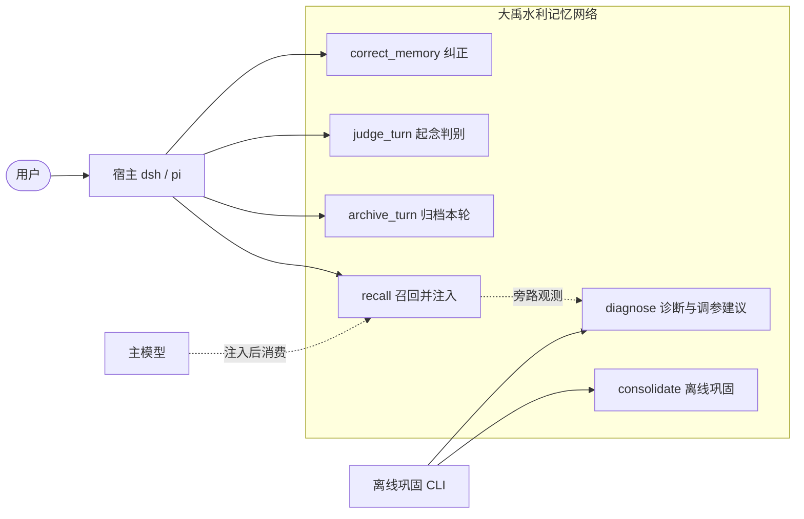
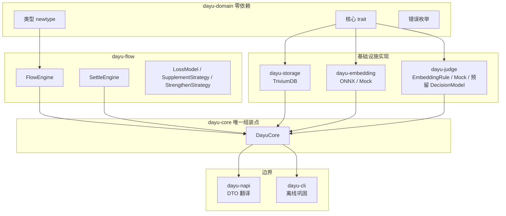
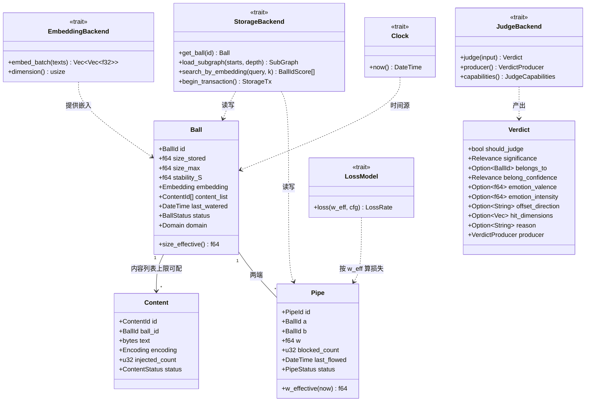
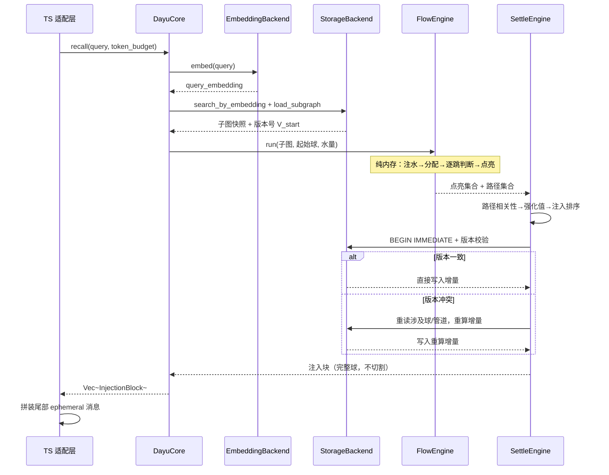
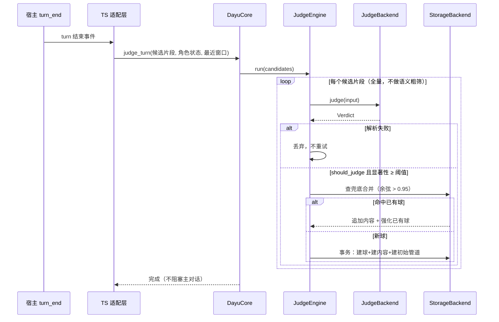
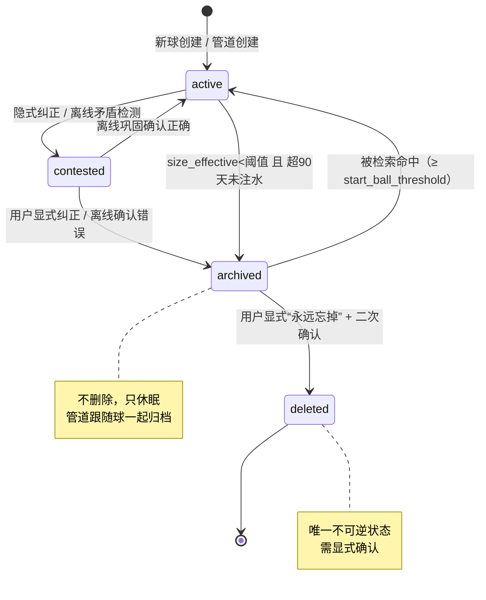
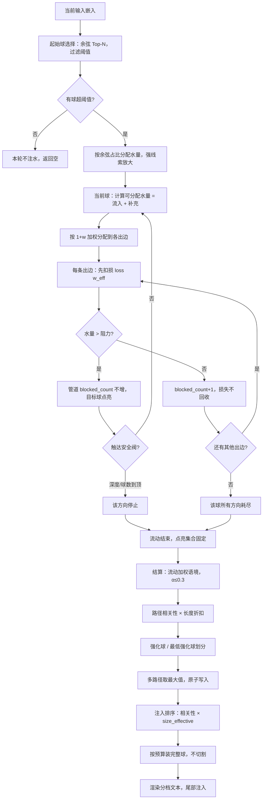
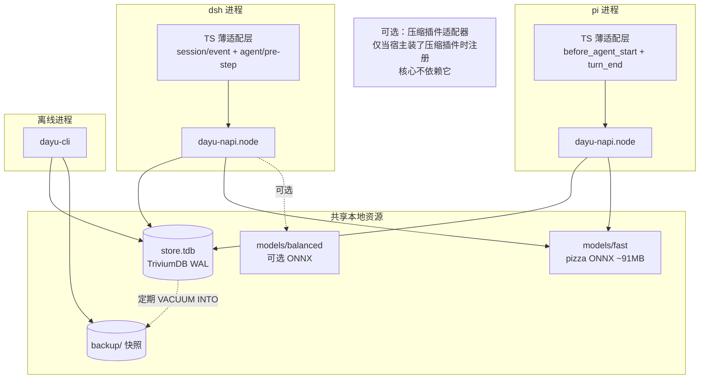
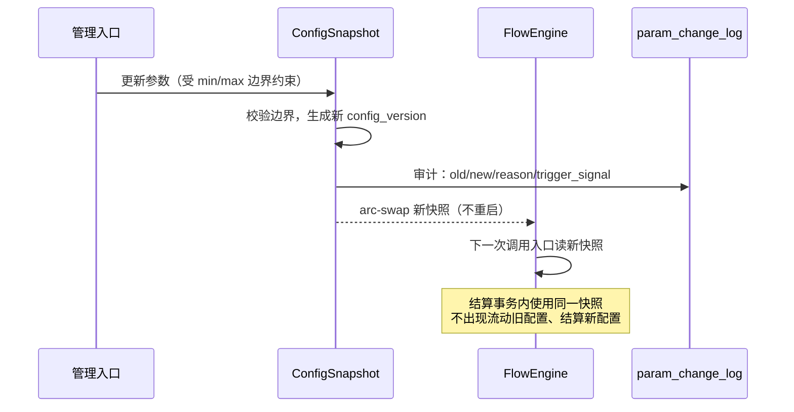

以下按“必要 → 重要 → 可选”三级给出 UML 图集，全部用 Mermaid 语法，可直接粘贴到支持 Mermaid 的编辑器渲染。

---

## 一、用例图（必要）

回答“系统对外提供什么能力、谁在用”。

**为什么必要**：`recall`/`archive_turn` 是每轮对话的同步路径，`judge_turn` 是异步旁路，`correct_memory` 是用户显式操作，`consolidate`/`diagnose` 是离线路径。这六条用例划清了在线与离线、同步与异步的边界。

---

## 二、组件图（必要）

回答“代码怎么分层、依赖方向是否单向”。

**为什么必要**：依赖方向必须单向——`dayu-domain` 零依赖，`dayu-flow`/`dayu-judge` 只依赖 trait 不依赖实现，`dayu-core` 是唯一知道所有实现的地方，`dayu-napi` 只做 DTO 翻译。这张图是“模块可独立测试、可替换”的编译期依据。

---

## 三、类图（必要，核心领域模型）

回答“球、管道、内容、判定、后端抽象之间是什么关系”。

**为什么必要**：这张图固定了三个关键契约——`size_stored` 与 `size_effective()` 的分离（新鲜度只算一次）、`Verdict` 的必填/可选字段分组、四个核心 trait 的方法集。后面所有实现都以此为契约。

---

## 四、时序图：recall（必要，在线同步路径）

回答“一轮对话开始时，注入是怎么同步完成的”。

**为什么必要**：它把“流动只点亮、结算才写入、结算即注入决策、版本冲突重算”四个关键约束画在了同一条时序上。

---

## 五、时序图：judge_turn（必要，异步旁路）

回答“判别器怎么在不阻塞主对话的前提下产生新球”。

**为什么必要**：它固定了“判别异步、失败不重试、兜底合并先于建新球、新球事务原子”四个契约。

---

## 六、状态图：球与管道的生命周期（必要）

回答“球和管道在什么条件下转换状态，什么时候归档、什么时候可唤醒”。

**为什么必要**：这张图是“疏而不堵”在状态层面的直接表达——`archived` 可被强线索唤醒，只有 `deleted` 不可逆。

---

## 七、活动图：流动与结算（必要，算法主流程）

回答“水从起始球到注入块，经过了哪些判定”。

**为什么必要**：它把“先分配后判断、损失不回收、1+w 加权、安全阀、不切割完整球”全部画在一条流程上，是流动与结算的唯一权威流程图。

---

## 八、部署图（必要）

回答“dsh、pi、napi、TriviumDB、ONNX 模型在物理上怎么放”。

**为什么必要**：它说明“单文件 TriviumDB + 进程级文件锁”如何支撑 dsh 和 pi 共享同一份记忆，以及 ONNX 模型作为数据文件、离线 CLI 作为独立进程的部署形态。

---

## 九、可选：配置热更新时序（重要但非核心）

---

### 必要 vs 可选汇总

| 图 | 级别 | 理由 |
|---|---|---|
| 用例图 | **必要** | 划清在线/离线、同步/异步边界 |
| 组件图 | **必要** | 依赖方向是独立测试和可替换的前提 |
| 类图 | **必要** | 固定 `size_stored`/`size_effective`、`Verdict` 分组、四个核心 trait |
| recall 时序 | **必要** | 固定“流动只点亮、结算即注入、版本冲突重算” |
| judge_turn 时序 | **必要** | 固定“异步旁路、失败不重试、兜底合并先于建球” |
| 状态图 | **必要** | “疏而不堵”在状态层的直接表达 |
| 活动图 | **必要** | 流动与结算的唯一权威流程 |
| 部署图 | **必要** | 多客户端共享单文件、模型作为数据文件、CLI 独立进程 |
| 配置热更新时序 | 可选 | 重要但属于运维层，不改变核心行为 |
